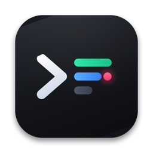
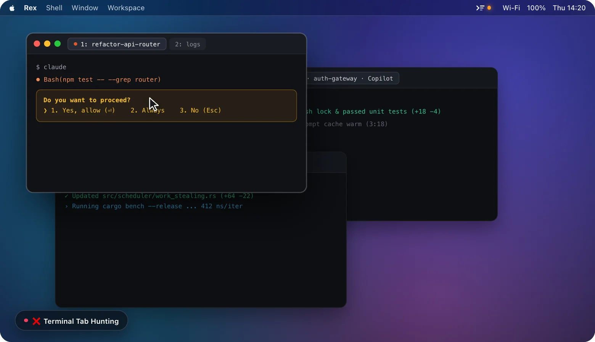

<p align="center">
  
</p>

<h1 align="center">Agent Meter</h1>

<p align="center">
  English | <a href="./README_zh.md">简体中文</a>
</p>

<p align="center">
  
</p>

A native macOS menu bar CLI Agent monitor for **[Rex](https://www.superlogical.com/)** and **[Ghostty](https://ghostty.org/)**. It detects active **Claude Code**, **Codex CLI**, **Copilot CLI**, and **Antigravity CLI** sessions running locally or over **SSH** in real time, letting you manage all agents from the menu bar without breaking your coding flow.

## Why Agent Meter?

- **Stop Babysitting `y/n` Prompts**: Get an instant amber menu bar alert the moment an agent pauses for permission, and click **`Allow ⏎`**, **`2`**, or **`Deny Esc`** inline without leaving your current window.
- **No More Tab Hunting (`Rex` & `Ghostty`)**: Preview the latest terminal output of all local and SSH sessions in one place, and press **`⌥ + Return`** (or click any card) to jump straight to the exact **[Rex](https://www.superlogical.com/)** or **[Ghostty](https://ghostty.org/)** window, tab, and split pane.
- **Git Branch, Worktree (`WT`) & Conflict Warnings**: Automatically surfaces the active Git branch, highlights isolated Git worktrees (`WT`), and warns with an amber **`Conflict`** badge when multiple agents share the same working directory.
- **Live Telemetry (`Diff +N -M` · `Cache 4:42` · `Context %`)**: Track working-tree line changes (`Diff +142 -28`), a 5-minute warm prompt cache countdown (`● Cache 4:42`), and a 5-segment context window meter (`64%`) on every session card.
- **Inline Quick Reply (`/`) & Soft Interrupt (`Stop ^C`)**: Send follow-up prompts or `/compact` directly from the card, or click **`Stop ^C`** on hover to send `Esc` / `Ctrl+C` and interrupt a turn without closing the terminal tab.
- **1-Click Local & SSH Workspace Launch (`+`)**: Auto-discovers recent local directories and remote SSH hosts (`~/.ssh/config` & live SSH sessions) with a **`Rex | Ghostty`** host switcher and 4 one-click agent launch buttons (**`Codex`**, **`Claude`**, **`Copilot`**, **`Antigravity`**).
- **Historical Session Search, Resume & Safe Delete**: Browse, filter, and search historical sessions across all 4 agents to resume them in **Rex** or **Ghostty** with one click, or permanently clean up session files with 2-step confirmation.

## Keyboard Shortcuts

| Shortcut | Action |
| :--- | :--- |
| `⌥ + Space` (`Option + Space`) | Toggle Agent Meter menu bar panel |
| `⌥ + Return` (`Option + Return`) | Jump straight to the #1 most urgent agent session |
| `↑` / `↓` | Select previous / next session item in the open panel |
| `←` / `→` | Switch between `All` / `Active` / `Done` filter tabs (or agent filters in New / History view) |
| `Return ⏎` | Approve pending permission (`Confirm` state) or jump to the selected terminal session |
| `/` | Open and focus the inline quick reply box on the selected session (or focus search in History view) |
| `Esc` | Exit inline input / sub-view, or close the panel |

*(Global shortcuts, preferred terminal host (`Auto` / `Rex` / `Ghostty`), and custom per-agent launch commands can be configured in Settings.)*

## Requirements

- macOS 14.0+
- **[Rex](https://www.superlogical.com/)** or **[Ghostty](https://ghostty.org/)** terminal
- Swift 6.0+ (Xcode Command Line Tools)

## Build & Run

Build the `.app` bundle and open it:

```sh
zsh scripts/build-app.sh
open "build/Agent Meter.app" --args --show-panel
```

Or build directly with Swift Package Manager:

```sh
swift build -c release
```

Demo mode:

```sh
open -n "build/Agent Meter.app" --args --demo --show-panel
```

## Roadmap / TODO

- [x] **Inline Quick Reply (`/`) & Soft Interrupt (`Stop ^C`)**: Send follow-up prompts or `/compact` directly from the menu bar popover, or interrupt a running turn with `Stop ^C` without closing the session.
- [x] **Prompt Cache Warm Timer (`Cache 4:42`)**: Display a 5-minute warm cache countdown on newly completed/idle sessions (Claude Code, Codex CLI, etc.) so you can follow up before prompt cache eviction causes slow TTFT and costly token re-prefills.
- [x] **Launch at Login**: Automatically start Agent Meter in the background when logging into macOS.
- [x] **Historical Session Search, Resume & Physical Delete**: Browse, filter, and search local historical sessions across Claude Code, Codex CLI, Copilot CLI, and Antigravity, resume any conversation in a new Rex or Ghostty tab with one click, or permanently delete session data with 2-step confirmation.
- [x] **Git Diff (`+64 -22`), Branch, Worktree (`WT`) & Conflict Detection**: Display live working-tree line additions/deletions, branch name, isolated Git worktree badge (`WT`), and multi-agent checkout collision alerts (`Conflict`).
- [x] **Unified Local & SSH Workspace Launch (`+`)**: Auto-discover local directories and remote SSH hosts (`~/.ssh/config` & live SSH sessions) with 4 one-click agent launch buttons (`Codex`, `Claude`, `Copilot`, `Antigravity`) and customizable launch commands.
- [x] **Dual Terminal Host Support (`Rex` & `Ghostty`)**: Full session discovery, terminal output preview, inline approval/reply, and 1-click tab/pane jump across both **Rex** and **Ghostty**.
- [x] **Full Keyboard Navigation**: Navigate cards, workspaces, and history with `↑`/`↓`, switch filters/agents with `←`/`→`, approve or launch with `⏎`, and focus inline reply or search with `/`.

