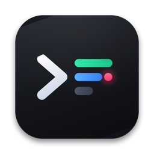
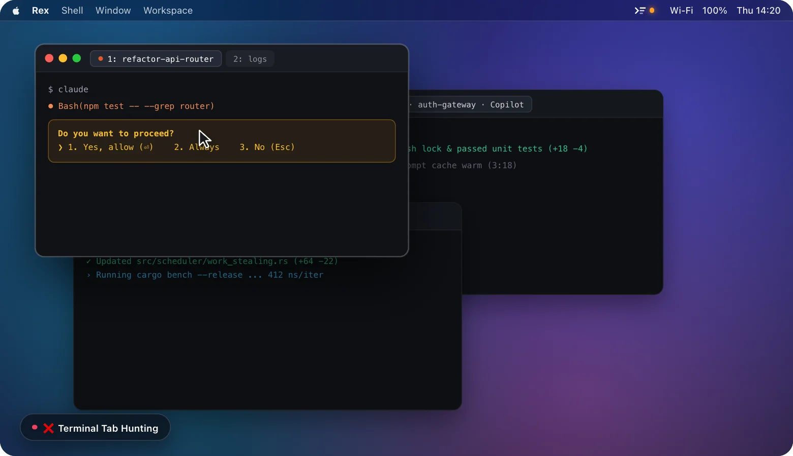

<p align="center">
  
</p>

<h1 align="center">Agent Meter</h1>

<p align="center">
  <a href="./README.md">English</a> | 简体中文
</p>

<p align="center">
  
</p>

原生 macOS 菜单栏 CLI Agent 监控工具（**仅支持 Rex 终端**），实时检测在 **Rex** 中运行的 **Claude Code**、**Codex CLI**、**Copilot CLI** 与 **Antigravity CLI** 会话状态，让你无需离开当前工作窗口即可在菜单栏掌控所有 Agent。

## 为什么使用 Agent Meter？

- **告别「保姆式盯梢」与权限卡死**：当后台 Agent 停在 `y/n` 等待权限确认时，菜单栏图标立即亮起琥珀色提醒；无需切换窗口，直接在菜单栏点击 **`允许 ⏎`** 或 **`拒绝 Esc`** 原地放行。
- **不再来回翻找终端与 Tab**：集中预览本机与远程 SSH 会话的最新终端输出，按 **`⌥ + Return`**（或点击任意卡片）即可一键精准跳转到对应的 **Rex** 窗口与 Tab。
- **提前预警 Context 爆仓压缩**：内置 5 段式上下文容量指示（`%`），在任务中途触发自动压缩（auto-compact）前及时感知。
- **一键开启新 Agent 会话**：在面板点击 **`+`** 即可选择常用工作目录，直接在 Rex 新建 Tab 启动对应的 CLI Agent。

## 全局快捷键

| 快捷键 | 功能说明 |
| :--- | :--- |
| `⌥ + Space`（`Option + Space`） | 唤起或收起 Agent Meter 菜单栏面板 |
| `⌥ + Return`（`Option + Return`） | 一键直接跳转到当前最紧急的 Rex Agent 会话 |

*（可在面板设置中随时开启或关闭全局快捷键。）*

## 环境要求

- macOS 14.0+
- **Rex** 终端（仅支持 Rex，不支持其他终端应用）
- Swift 6.0+（Xcode Command Line Tools）

## 编译与运行

使用打包脚本构建 `.app` 应用包并运行：

```sh
zsh scripts/build-app.sh
open "build/Agent Meter.app" --args --show-panel
```

也可以直接使用 Swift Package Manager 编译：

```sh
swift build -c release
```

演示模式：

```sh
open -n "build/Agent Meter.app" --args --demo --show-panel
```

## 后续计划 / TODO

- [x] **菜单栏内直接快捷回复（Inline Quick Reply）**：支持在面板卡片内直接输入一句话指令或快捷发送常用命令（如 `/compact`、`continue`）至对应的 Rex 终端，无需切换窗口。
- [x] **Prompt Cache 热缓存保温倒计时（Prompt Cache Warm Timer）**：针对刚完成或空闲的会话（Claude Code、Codex CLI 等）提供 5 分钟热缓存倒计时提醒，避免闲置超时导致缓存失效（Cache Miss）、响应变慢与额度额外消耗。
- [x] **开机自动启动（Launch at Login）**：支持登录 macOS 时在后台自动启动 Agent Meter。

